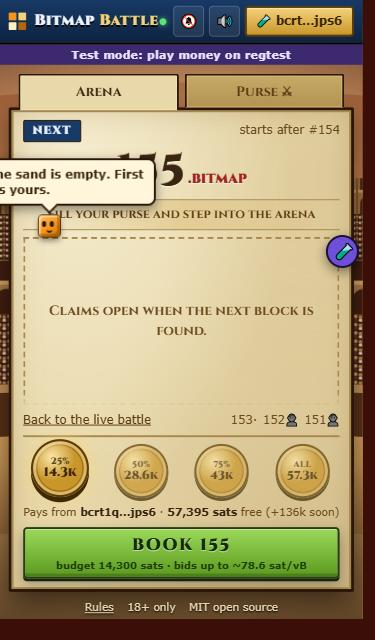
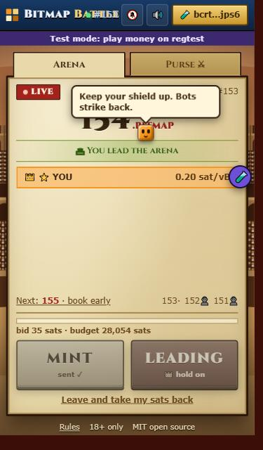
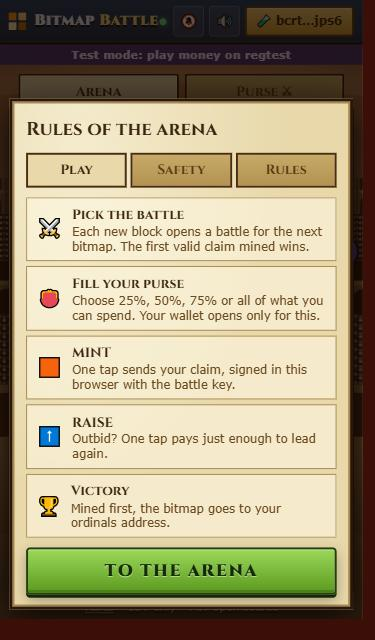
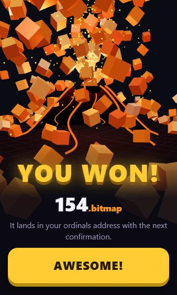

# Bitmap Battle

A mobile web app for bitmap mint battles. Every new block opens a battle for the next bitmap number. Players
claim it with one tap and outbid with another. The first valid claim in a block wins, and the winner gets Vesuvius
of bitmap blocks.

Players sign and broadcast everything themselves, in their own browser and wallet. The server only watches its
own Bitcoin node and shows the live battle (and, for a ghost run, sends the claims the player already signed). Every view fits one phone screen with no scrolling, from a small
iPhone SE inside the Xverse browser up to a tablet.

| The arena | In the fight | Rules | You won |
| --- | --- | --- | --- |
|  |  |  |  |

It looks like an old-school browser arena game: parchment panels, a Roman amphitheatre at sunset and bevelled
buttons, all on one page. A small orange cube hops around and takes tips. It speaks when you tap it, or when something
important happens in your battle: a new block, your coins arriving, being outbid, taking the lead, the result.

## How a battle works

1. **Pick a table.** When block N-1 is found, the battle for `N.bitmap` starts. The app shows every claim for N
   waiting in the mempool, best first. The leader wears the crown.
2. **Deposit a budget.** The app reads the coins of your Xverse payment address (the Preferred Bitcoin Address:
   Native or Nested SegWit, never Taproot). It keeps back a generous fee for the deposit itself and offers four
   budgets: 25%, 50%, 75% or all of the rest. Every option is one the address can pay, and the coins are read
   again right before the wallet opens. Xverse sends the chosen budget to a one-time address made for this battle
   (`sendTransfer`). This is the only time the wallet opens. You can never lose more than this budget.
3. **MINT.** One tap sends the claim, signed in the browser with the battle's own key. It inscribes `N.bitmap`
   (`text/plain`, 168 vB like the bitmap bot's claims) with locktime N-1, so no miner can put it in a block before N, where it would not
   count. The inscription goes to your ordinals address and the change back to your payment address.
4. **RAISE.** When someone bids more, the screen turns red. One tap replaces your claim with the lowest fee that
   leads again (replace-by-fee): 0.01 sat/vB above the best rival, or the relay minimum for a replacement if that
   is more. The fee is priced the way miners rank it: by its chunk's fee rate, so a deposit
   still waiting in the mempool is counted.
5. **Block found.** The app checks who holds `N.bitmap` now. If it's you, Vesuvius erupts over Pompeii: an ash
   column spreading like an umbrella pine, volcanic lightning, and the won block thrown out as glowing stones,
   one per transaction of the winning block.

**Leave** at any time before the block. A key-path spend sends the deposit back to your payment address. It also
cancels a claim that is still waiting, so nothing is inscribed.

**Who is fighting.** Every claim shows its fee rate and, under it, the most it can still raise to with the coins it
already spends (`max 174k` sat/vB; `all in` when nothing is left). The app tells three kinds of claimers apart:

- 🤖 **Bot**: the bitmap bot, which signs every claim with the same key.
- 👻 **Ghost**: someone whose claim was mined by a pool that takes private submissions (MARA Pool, SpiderPool)
  without ever reaching this node's mempool. Ghosts can't be seen or outbid before the block. A ghost is named
  after the address its bitmaps go to, since it may sign every claim with a new key. The server learns ghosts from
  its own node and keeps them in `data/<network>/ghosts.json`.
- 👤 **Minter**: everyone else, including Bitmap Battle players.

**👻 Ghost mint** (regtest for now). Some minters send their claims straight to a mining pool's private mempool,
where nobody can see or outbid them before the block. A ghost run does the same:

1. Pick a start fee, how far it may rise, and how many blocks to chase. The deposit is computed for you.
2. Your wallet signs the deposit once. It goes to one Taproot address whose tree holds a claim for every number
   of the run.
3. Your browser signs every claim of the run at a ladder of fees, plus refunds, and hands them to the server. The
   server checks each one pays only your addresses.
4. Every block, the server sends the claim for the newest bitmap to the private pool, checking the pool's fee floor
   first. Because it spends the same deposit, it replaces the claim from the block before, so only the claim
   that finally gets mined pays a fee. You can close the page.
5. It ends when a claim wins, when you stop, or when the chase is over: then your deposit comes back by a public
   refund.

On regtest the server holds a stand-in private pool, and the 🧪 test panel can mine a "MARA block" and run a
private rival. `scripts/e2e-ghost.ts` plays whole runs against it.

**Past battles** are in the hall of fame. Tap a champion to see every claim in that block, the fee each one paid,
and a mempool link for each.

**Older bitmaps nobody owns** are listed in the hall of fame (the Fame tab on a phone). One tap on **MINT NOW**
deposits, and the claim goes out by itself as soon as the deposit lands. When someone else claims one of them, the
arena shows an **open fight** link, and the battle works like any other.

**Your purse** lists every battle. Tap one to see its deposit, claims and refund, each with a link to
mempool.space. Tap a shortened address anywhere and the cube reads it out in full.

## Who does what

| Part | Does | Never does |
| --- | --- | --- |
| Your phone (browser + Xverse) | Makes the battle key, builds and signs every claim, sends it to public relays ([mempool.space](https://mempool.space), [blockstream.info](https://blockstream.info)) | Sends keys anywhere |
| The server | Reads its own Bitcoin Core: blocks, mempool, fee rates, cluster ranks. Holds one seat per table so app players never fight each other. Sends battle alerts. For a ghost run, sends the claims and refund the player already signed | Holds keys or coins, changes or signs transactions |

If the server disappears, nobody's coins are at risk. Each battle's key stays in the browser, and "My battles" can
download a backup that any copy of this app can use to take the deposit back.

Wins are judged with the rules of `bitmap_index.py`:
- the body is exactly `<n>.bitmap`, with no spaces or leading zeros;
- the content type starts with `text/plain`;
- the body is not compressed;
- `n` is not above the height of the block that holds the claim;
- the first claim in chain order wins;
- cursed inscriptions count like any other.

## Run it on your node (Windows)

You need:

- Node.js 22.13 or newer.
- Bitcoin Core on the same machine, with `server=1` and `txindex=1`. With `rest=1`, blocks are read faster.
- Bitcoin Core 31 or newer, for exact cluster ranks. Older versions fall back to ancestor fee rates.

Get the code and start it:

```
git clone https://github.com/sixoBitmap/bitmap-battle
cd bitmap-battle
start_mainnet.cmd
```

- The launcher installs and builds the app on first run, then serves it at http://localhost:8787.
- It logs in with the node's `.cookie`. It looks in `<drive>:\Bitcoin Core\data` and `%APPDATA%\Bitcoin`; use `--rpc-cookie` to point elsewhere.
- If a `bitmap_index.py` database is found at `<drive>:\Bitmap Index\bitmaps.sqlite` (any drive), the server uses it and scans only the newer blocks. Without one, it can only judge bitmaps from the blocks it has scanned itself.

Other systems:

```
npm install
npm run build
npm start -- --network mainnet --rpc-cookie ~/.bitcoin/.cookie
```

### Options

| Option | Default | |
| --- | --- | --- |
| `--network` | `mainnet` | `mainnet`, `testnet`, `testnet4`, `signet` or `regtest` |
| `--rpc-url` | `http://127.0.0.1:8332` (per network) | Bitcoin Core RPC |
| `--rpc-cookie` / `--rpc-user` + `--rpc-password` | found automatically | RPC login |
| `--bitmap-db` | none | `bitmaps.sqlite` from `bitmap_index.py`, read only |
| `--host`, `--port` | `127.0.0.1`, `8787` | Use `--host 0.0.0.0` to reach it from your Wi-Fi |
| `--data-dir` | `data/<network>` | Scanned claims, alert keys and subscriptions |
| `--poll-ms` | `2000` | How often the node is read |
| `--vapid-subject` | a noreply address | Contact for web push services, `mailto:` or `https:` |
| `--tip-address` | none | Your address for tips. Without it the tip cube and tip buttons are hidden |
| `--tip-amounts` | `1000,5000,21000` | The tip buttons, in sats |

Every option can also be set as an environment variable, like `BB_NETWORK` or `BB_RPC_URL`.

## Tips

Players can thank whoever runs the server. After a win, the Vesuvius screen and the win card show one-tap tip
amounts. Anywhere in the app, a small orange cube with a face hops between page elements, squashing and stretching.
Tap it and it bursts into hearts and offers the same tip amounts. Every tip is a normal wallet transfer that the
player confirms in Xverse.

To turn tips on, put your Bitcoin address on one line in `tip-address.txt` next to `start_mainnet.cmd`, or pass
`--tip-address`. The cube only lands where neither its body nor a margin around it touches a button, and never near
the battle buttons, so a tap that misses a hopping cube cannot press FIGHT, MINT or RAISE. It also rests while
someone is tapping around the page.

## Soundtrack

The arena has its own soundtrack, played live by the browser (no audio files): war drums, a dark drone, a
plucked lyre over D minor, B flat, C and A, and a Roman horn call. It follows the battle. It is quiet while
you watch, the drums join when fighters arrive, the horn sounds when you mint or lead, and it gets more urgent
when you are outbid. It goes silent for the Vesuvius celebration. Browsers allow sound only after a tap, so the
music starts with the first tap.

One button in the top bar sets how the app gets your attention, and its icon shows the mode: 🎶 music and sounds,
🔔 battle alerts only (no music), or 🔇 silent.

## Put it on your phone

Wallets and battle alerts need **https**. The quickest way, with no account and no router changes, is a free
Cloudflare quick tunnel:

```
start_online.cmd
```

1. It starts the app if it is not running, then opens the tunnel.
2. It prints the public `https://….trycloudflare.com` address, and a QR code that opens the app inside the **Xverse
   app's browser**, where the wallet can sign.
3. Keep its window open. Closing it takes the app offline.
4. The app's own window (`start_mainnet.cmd`) prints the same link and QR code at start, whenever the address
   changes and every hour, and says whether the link answers. That window also restarts the server by itself if
   it ever stops with an error (logged in `data
estarts.log`).

It looks for `cloudflared` in `tools\` (download the signed `cloudflared-windows-amd64.exe` from Cloudflare's GitHub
releases and save it there as `cloudflared.exe`), in Program Files, or on the path. On other systems:
`npm run online`. On a phone browser without Xverse, the Connect button offers to open the page in Xverse.

Battle alerts (web push) are tied to the site's address. Use a named tunnel or your own domain if subscribers
should survive a restart. On iPhone, alerts work once the app is added to the home screen (iOS 16.4+).

The server limits requests per address and caps unfunded seats per address. It is still your node behind it:
keep it on a machine you are happy to expose, ideally not your daily PC.

## Try it with play money

```
start_regtest.cmd
```

This starts a private regtest node and the server at http://localhost:8788, with:

- a test wallet that stands in for Xverse;
- a rival bot that fights like the real one: it claims a few seconds after each block and raises when outbid, up
  to its maximum;
- a purple 🧪 panel to get 0.01 test BTC (confirmed at once), mine blocks, switch the bot on and off, set its
  maximum, or mine automatically. Like Xverse, the test wallet pays deposits and tips only from its payment
  address and sends the change back to it.

On other systems, run `npm run regtest`. To use a `bitcoind` that is not on the path, add `-- --bitcoind <path>`.

## Development

```
npm test          # unit tests, with real mainnet claims as fixtures
npm run e2e       # full battles against the regtest server: a win with raises, a loss, a deposit taken back
npm run typecheck
npm run dev:web   # Vite dev server on :5173, proxied to a server on :8787 (BB_SERVER to change)
```

Layout:

```
packages/core   claim parsing (port of bitmap_index.py), claim/raise/refund transactions, chunk-rate pricing
apps/server     node watcher, tables, seats, alerts, HTTP + WebSocket, regtest tools
apps/web        the mobile app (React), Xverse via sats-connect, the three.js Vesuvius
scripts         regtest launcher, end-to-end test, icon generator
```

## Honest limits

- **Losing costs money.** A losing claim usually still gets mined, and its fee is spent. The duplicate inscription
  and the change go back to you.
- **Bots are fast.** Bots react in milliseconds, and a human tapping RAISE is slower.
- **Miner order.** Miners usually take higher fee rates first, but not always.
- **Deposit fee.** Xverse picks the deposit's fee. When the deposit is still unconfirmed, the claim pays for both
  (its quote counts this). **Prepare** for the next battle (🛡️ on the arena) and the deposit confirms before the fight, so the claim stands alone.
- **One app player per bitmap.** This is a rule of this server, not of Bitcoin. Other copies of the app, and
  everyone else, can still bid.
- **Adults only (18+).** This is a fee auction between players. There is no house. A ghost run's chance depends on how often
  its private pool mines a block.

Not affiliated with Xverse, ord or the bitmap community. MIT licensed: see [LICENSE](LICENSE).
